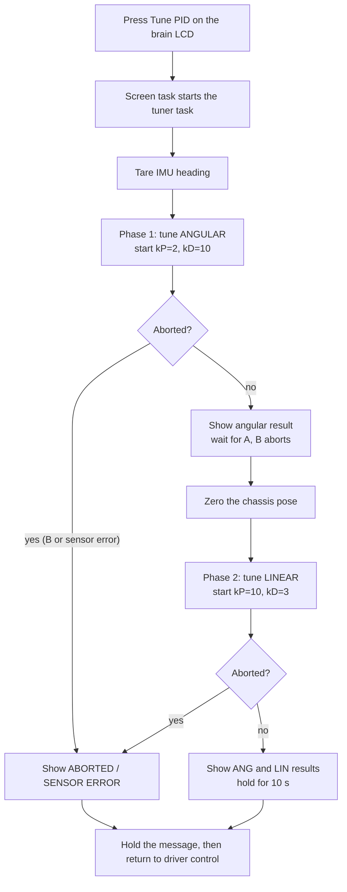
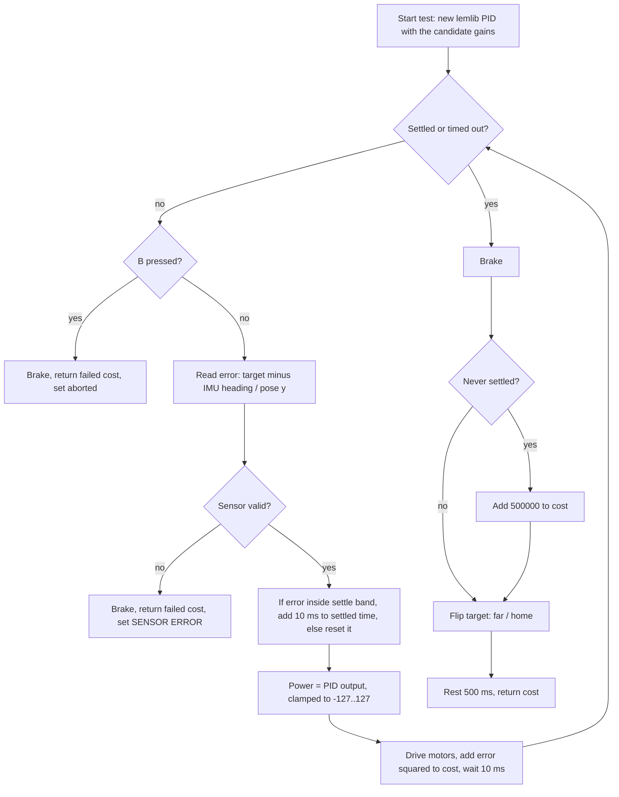
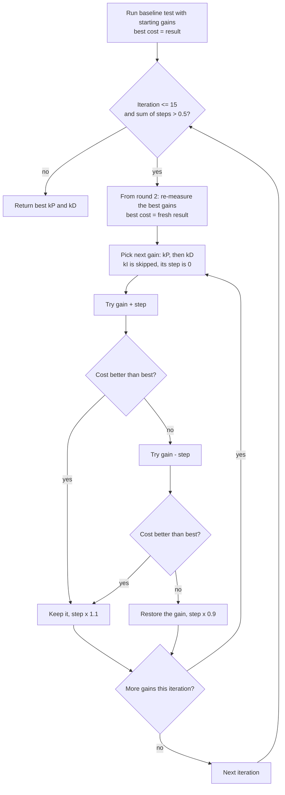

# PID Tuning Guide

This explains what the PID tuner in this project does, how it runs, and how each setting changes the robot's behavior. The code is in `src/pid_tuner.cpp`, and `src/main.cpp` starts it.

> **Status:** the tuner has not been compiled or run on a robot yet. Treat what it reports as starting points and check them with real `turnToHeading` and `moveToPoint` motions.

---

## 1. What the tuner does

The robot's autonomous moves (`turnToHeading`, `moveToPoint`, `moveToPose`) are driven by two PID controllers: one for **angular** (turning) and one for **lateral/linear** (driving). Each needs gains, `kP` and `kD`, that suit this robot.

The tuner finds those gains automatically. It repeats this cycle:

1. Move the robot (a 90° turn, then a 48" drive) with a candidate `kP` and `kD`.
2. Score how well the move went (the **cost**; lower is better).
3. Change one gain slightly, and keep the change if the score improved.

The search method is called **Twiddle**. It only tunes `kP` and `kD`; `kI` stays 0. This follows the LemLib docs, which call `kI` "a last resort".

The tuner only **displays** its results on the controller. You copy them into `ControllerSettings` in `src/main.cpp` yourself.

## 2. How to run it

1. Put the robot on a clear floor with at least **48 inches** free in front of it.
2. On the brain, press the right LCD button, **Tune PID**.
3. Watch the **controller screen**. The brain LCD is not used while tuning.
4. When angular tuning ends, the controller shows the result and waits. Move the robot if you need to, then press **A** to start linear tuning.
5. When it finishes, the controller shows both results (`ANG P:.. D:..`, `LIN P:.. D:..`). They stay for 10 seconds, then driving resumes.
6. Hold **B** at any time to abort.

| Button | When | Effect |
|---|---|---|
| LCD right button | any time the tuner is idle | start tuning |
| **A** | after angular tuning | start linear tuning |
| **B** | any time during tuning | abort |

## 3. Overall flow



## 4. One test move

Each trial runs one move with a given `kP` and `kD` and returns a cost.



- **Angular:** the target alternates between 90° and 0°, with the motors spinning the robot in place.
- **Linear:** the target alternates between 48" and 0" on the Y axis, with both sides driving forward.
- **Settled** means the error stays inside the settle band (1.5° angular, 1.0" linear) for 200 ms.
- **Timeout** is 2.5 s for angular and 4 s for linear.

### The cost

`cost = sum of (error squared)`, taken every 10 ms, plus 500,000 if the move never settled.

| Behavior | Effect on cost |
|---|---|
| Fast and accurate | Low: the error shrinks quickly |
| Slow | Higher: the error stays large for many ticks |
| Overshoot | Higher: the error is large on the other side |
| Oscillation that never settles | Very high: times out and takes the 500,000 penalty |

Because oscillation is punished, the tuner naturally avoids gains that make the robot shake.

## 5. The search (Twiddle)

Twiddle keeps a current value (`p`) and a step size (`dp`) for each gain. It nudges one gain at a time:



- **Re-baselining handles drift.** Battery sag, warming motors and wheel slip change the cost over a long run, so an old "best cost" is not comparable to a new one. From round 2 the tuner re-runs the best gains first and judges that round's changes against the fresh number. This adds one extra test per round.
- **Success grows the step** (x 1.1) so the search speeds up while it is improving.
- **Failure shrinks the step** (x 0.9) so it settles in on a best value.
- It stops when the steps are small (sum below 0.5) or after **15 iterations**.
- A trial with a negative gain is never run, because it would drive the robot away from the target. Its cost is infinity so it can never count as an improvement.
- **Drivetrain brake:** the tuner holds the wheels at the end of each test (so the robot stops where the test ended) and restores coast when it finishes. During the wait between phases the wheels are free so you can move the robot by hand.

### Starting values

These are the LemLib docs' example gains. Each step is about 10% of its gain.

| | Start `kP` | Start `kD` | Step on `kP` | Step on `kD` |
|---|---|---|---|---|
| Angular | 2.0 | 10.0 | 0.2 | 1.0 |
| Linear | 10.0 | 3.0 | 1.0 | 0.3 |

---

## 6. How each parameter affects the robot

### The controller gains

The PID output is `error x kP + integral x kI + derivative x kD`. The error is in degrees (angular) or inches (linear). The derivative is the change in error per 10 ms tick.

| Gain | What it does | Too low | Too high |
|---|---|---|---|
| **`kP`** (proportional) | Pushes harder the farther the robot is from the target. | Slow, or stops short of the target. | Overshoots, then oscillates. |
| **`kD`** (derivative) | Brakes as the robot approaches the target; damps overshoot. | Overshoot and wobble from `kP`. | Sluggish, jittery, or noisy, because it reacts to sensor noise. |
| **`kI`** (integral) | Slowly corrects a small error that remains after the robot stops. | Not corrected. | Overshoot and oscillation. |

Rules of thumb (from the LemLib docs' approach):

- Tune `kP` and `kD` **together**. They shape the whole movement.
- Raise `kP` until the robot oscillates, then raise `kD` until it stops. Repeat until no `kD` stops the oscillation. (The docs' flowchart image was not available to me, so this is the general method, not a copy of it.)
- `kI` is rarely needed. Use it only when `kP` and `kD` can't remove a steady-state error.

### What you see and what to change

| Symptom | Likely cause | Change |
|---|---|---|
| Robot stops short of the target | `kP` too low | Raise `kP` |
| Overshoots then returns | `kD` too low (or `kP` too high) | Raise `kD`, or lower `kP` |
| Shakes or oscillates around the target | `kP` too high or `kD` too low | Lower `kP`, or raise `kD` |
| Slow, creeping finish | `kD` too high | Lower `kD` |
| Twitchy, noisy motor sound | `kD` too high | Lower `kD` |
| Small error that never disappears | Steady-state error | Consider a small `kI` (last resort) |

### The tuner's own settings

These are constants at the top of `src/pid_tuner.cpp`.

| Setting | Value | What it controls |
|---|---|---|
| `ANGULAR_TEST_DEG` | 90 | Size of the test turn. |
| `LINEAR_TEST_IN` | 48 | Length of the test drive. Needs that much clear floor. |
| `LOOP_MS` | 10 | How often the PID runs. |
| `SETTLE_MS` | 200 | How long the error must stay in the band to count as settled. |
| Settle band | 1.5° / 1.0" | How close counts as "arrived". |
| Timeouts | 2.5 s / 4 s | Longest a single test can run. |
| `TIMEOUT_PENALTY` | 500,000 | Cost added to a move that never settles. |
| `FAILED_COST` | infinity | Cost of an aborted test or a gain that was never run. Never counts as an improvement. |
| `REST_MS` | 500 | Pause between tests so the robot stops moving. |
| `MAX_ITERATIONS` | 15 | Most Twiddle rounds per phase. |
| `TOLERANCE` | 0.5 | Stop once the step sizes total below this. |
| Step sizes | see section 5 | Bigger steps explore faster but can jump past a good value. |
| Start gains | see section 5 | The search only looks nearby, so start close to a working tune. |

## 7. After tuning

1. Copy the final gains into `ControllerSettings` in `src/main.cpp`:
   ```cpp
   // ControllerSettings(kP, kI, kD, antiWindup, smallError, smallErrorTimeout,
   //                    largeError, largeErrorTimeout, slew)
   lemlib::ControllerSettings linearController(<LIN P>, 0, <LIN D>, 3, 1, 100, 3, 500, 20);
   lemlib::ControllerSettings angularController(<ANG P>, 0, <ANG D>, 3, 1, 100, 3, 500, 0);
   ```
2. Test with real motions, such as `chassis.turnToHeading(90, 2000)` and `chassis.moveToPoint(0, 48, 4000)`.
3. Re-run the tuner if the battery, wheels, or weight of the robot change a lot.

## 8. Known limits

- **It does not run LemLib's actual motions.** The linear test drives straight with no heading correction, while `moveToPoint` also corrects heading. The angular and linear loops use `lemlib::PID`, but exit conditions and slew are not used.
- **Linear tuning depends on odometry.** It reads the robot's Y position, so a wrong tracking-wheel setup gives wrong gains.
- **Results are noisy.** Battery level, floor, and wheel slip change each run. Re-baselining each round reduces slow drift, but not run-to-run noise, so run the tuner more than once and compare.
- **Direction bias.** Tests alternate direction (0 to 90, then 90 to 0). If the robot behaves differently in each direction, the comparison between neighbouring trials is slightly unfair.
- **Only `kP` and `kD` are tuned.** Anti-windup, exit ranges, and slew in `main.cpp` stay as you set them.
